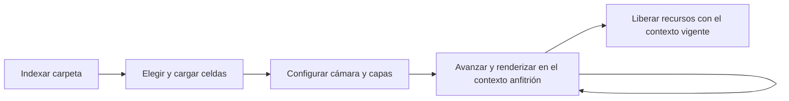

# ENC Viewer SDK

[](https://github.com/GiorgioCode/enc-viewer-sdk/actions/workflows/ci.yml)
[](LICENSE)

Biblioteca **C++17 y OpenGL** para incorporar cartas náuticas ENC S-57 a una
aplicación: indexación, lectura, simbología, navegación con el mouse, presentación
día/noche y superposición de GeoTIFF y radar.

El anfitrión controla la ventana, el contexto y el bucle de eventos. La biblioteca
expone `enc::viewer` y cabeceras públicas sin tipos GDAL, OpenGL o GLFW.
Incluye ejemplos de implementación y datos para probarla sin descargas adicionales.

**Estado:** prueba de concepto reutilizable, API inicial 0.1. Requiere OpenGL de
escritorio **2.1 o superior con perfil de compatibilidad**. Su simbología es un
subconjunto propio; no es una implementación certificada de S-52 ni un ECDIS.
Consultar [alcance y limitaciones](docs/alcance.md) antes de integrarla.

| Presentación diurna | Presentación nocturna |
| --- | --- |
|  |  |

## Capacidades

- Catálogo recursivo de celdas `.000`, metadatos DSID, escala, cobertura,
  actualizaciones vecinas, consultas espaciales e inventario JSON.
- Lectura con GDAL, atributos y profundidades, teselación con huecos,
  cargas transaccionales y cancelación entre celdas.
- Mundo incorporado al binario, encuadre, desplazamiento, zoom al cursor y selección.
- Símbolos vectoriales por atributos: boyas, balizas, luces, rocas y otras clases;
  catálogo de 44 ejemplos y controles de profundidades, etiquetas y sondas.
- Varias imágenes TIFF/GeoTIFF: reproyección, transparencia, orden y ajuste manual.
- PPI simulado o ecos geográficos aportados por el anfitrión; verde de día y rojo de noche.
- Composición en una región del framebuffer activo, HiDPI y conservación de estado GL.

## Compilación rápida

Validado en Linux. Se necesitan CMake ≥ 3.16, compilador C++17, GDAL ≥ 3.0 con
controlador S57, OpenGL y GLU. GLFW se utiliza únicamente en los ejemplos de ventana;
EGL/Mesa, en las pruebas gráficas. Python 3 añade verificaciones de desarrollo.

```sh
git clone https://github.com/GiorgioCode/enc-viewer-sdk.git
cd enc-viewer-sdk
sudo apt install build-essential cmake libgdal-dev libgl1-mesa-dev libglu1-mesa-dev
cmake -S . -B build/library -DCMAKE_BUILD_TYPE=Release
cmake --build build/library --parallel 2
cmake --install build/library --prefix "$PWD/install"
```

Por defecto se compila sólo la biblioteca. No requiere copiar recursos del mundo
al ejecutable; las cartas y las imágenes se reciben mediante rutas de la aplicación.

## Incorporación a una aplicación

Con el paquete instalado:

```cmake
find_package(EncSDK 0.1 REQUIRED CONFIG)
add_executable(mi_aplicacion main.cpp)
target_link_libraries(mi_aplicacion PRIVATE enc::viewer)
```

Configurar el anfitrión con `-DCMAKE_PREFIX_PATH=/ruta/al/paquete`. También se puede
incluir el código como subdirectorio, con las opciones predeterminadas:

```cmake
add_subdirectory(external/enc-viewer-sdk)
target_link_libraries(mi_aplicacion PRIVATE enc::viewer)
```

La API está en [`<enc/enc.h>`](include/enc/enc.h). La secuencia habitual es:



Los ejemplos [sin ventana](examples/minimal/index.cpp) y
[OpenGL mínimo](examples/minimal/opengl.cpp) contienen implementaciones compilables.
La [guía de integración](docs/integracion.md) explica el ciclo completo, errores,
coordenadas, concurrencia y propiedad de los recursos.

## Probar los ejemplos

Con CMake ≥ 3.21 se pueden usar los perfiles incluidos:

```sh
sudo apt install libglfw3-dev libegl1-mesa-dev python3
cmake --preset dev
cmake --build --preset dev
ctest --preset dev
./build/dev/examples/viewer/enc-viewer-demo ./sample-charts --radar --demo-tiff --night
```

El [ejemplo completo](examples/viewer/README.md) permite abrir carpetas, inspeccionar
objetos, apilar imágenes y controlar las capas y la presentación desde su interfaz.
Requiere una sesión gráfica. También se incluyen:

```sh
# Índice y lectura sin ventana ni contexto OpenGL.
./build/dev/enc-index ./sample-charts ./build/dev/inventory.json
# Ventana con navegación y código de integración mínimo.
./build/dev/enc-minimal ./sample-charts
```

Con CMake 3.16–3.20, configurar sin perfiles:

```sh
cmake -S . -B build/dev -DENC_BUILD_EXAMPLES=ON -DENC_BUILD_TOOLS=ON -DENC_BUILD_TESTS=ON
cmake --build build/dev --parallel 2
ctest --test-dir build/dev --output-on-failure
```

<a id="documentacion"></a>

## Documentación

| Guía | Contenido |
| --- | --- |
| [Integración](docs/integracion.md) | CMake, contexto, carga, interacción, capas y errores. |
| [API y contratos](docs/api.md) | Unidades, IDs, transacciones, hilos y recursos. |
| [Arquitectura](docs/arquitectura.md) | Módulos y diagramas PlantUML con SVG incluidos. |
| [Ejemplo completo](examples/viewer/README.md) | Controles y compilación independiente. |
| [Validación](docs/validacion.md) | Pruebas reproducibles y capturas del renderizador. |
| [Alcance](docs/alcance.md) | Capacidades y límites de integración. |
| [Mantenimiento](docs/mantenimiento.md) | Versiones, dependencias y empaquetado. |
| [Contribuciones](CONTRIBUTING.md) | Preparación del entorno y criterios de cambios. |
| [Cambios](CHANGELOG.md) | Registro de versiones. |
| [Seguridad](SECURITY.md) | Cómo comunicar vulnerabilidades. |

Los módulos incluyen encabezados y comentarios en español. Para comenzar a leer el
código, seguir `examples/minimal` → `include/enc` → `src`; el ejemplo de interfaz
completa está separado del motor.

## Licencia y datos

Código y documentación propios bajo [MIT](LICENSE). El mapa mundial y las celdas
de ejemplo mantienen sus respectivas condiciones y avisos de procedencia:
[mapa mundial](assets/README.md), [cartas NOAA](sample-charts/README.md) y
[componentes de terceros](THIRD_PARTY_NOTICES.md).
