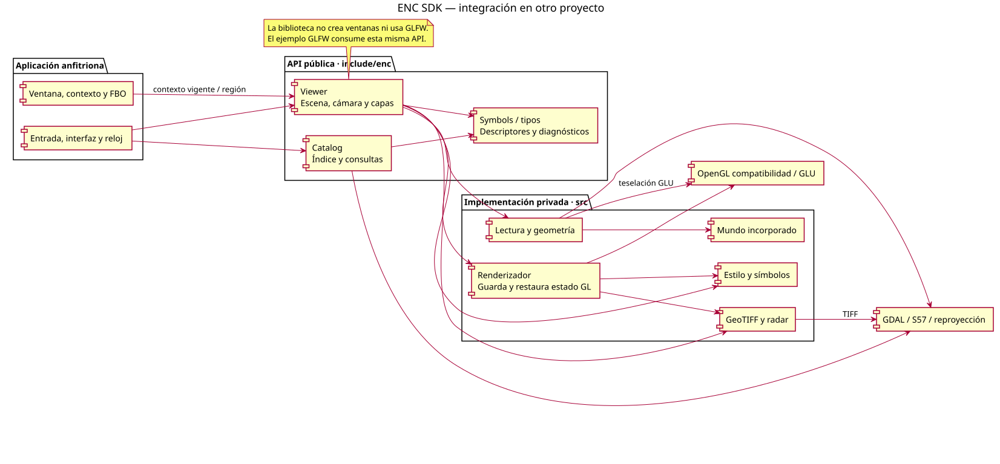
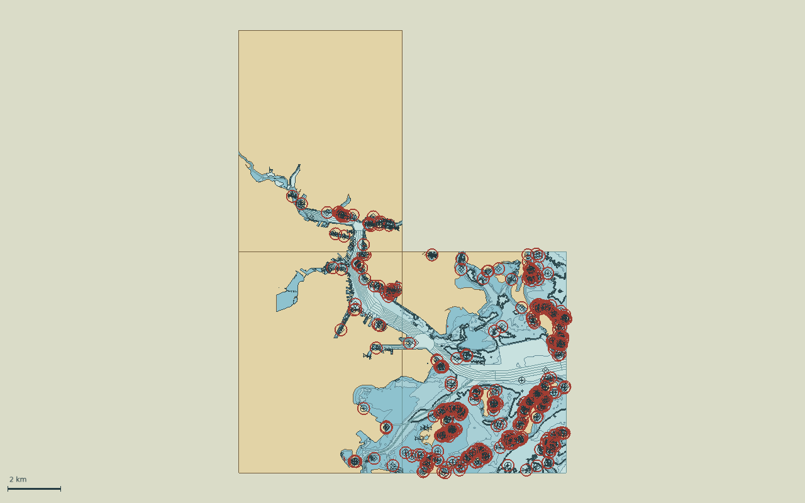
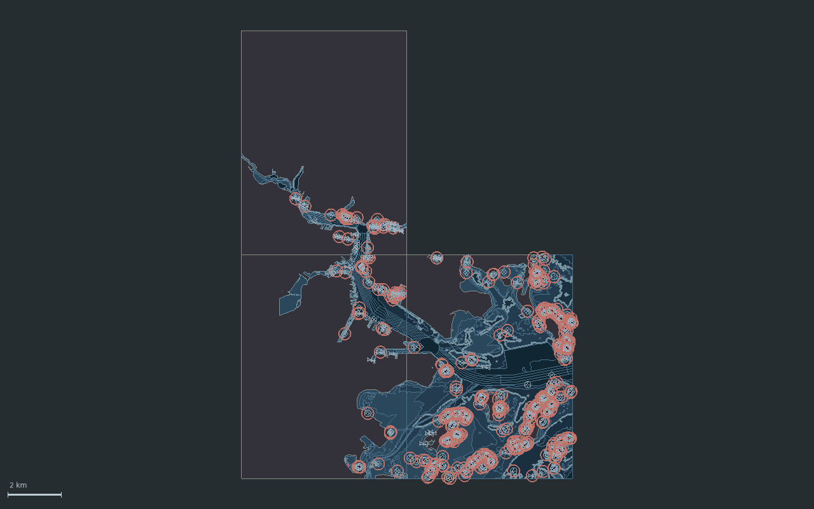
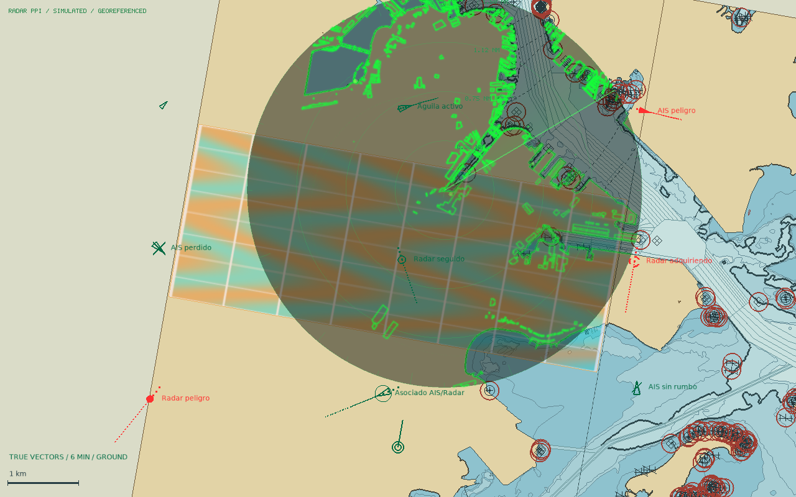
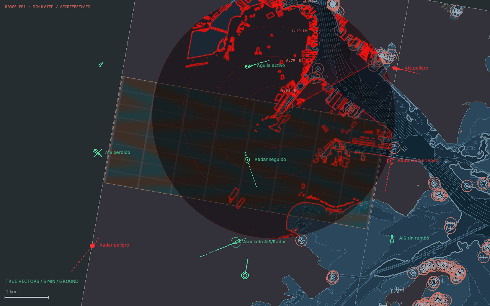

# ENC Viewer SDK

[](https://github.com/GiorgioCode/enc-viewer-sdk/actions/workflows/ci.yml)
[](LICENSE)

Biblioteca **C++17 y OpenGL** para integrar cartas náuticas ENC S-57, imágenes
GeoTIFF, radar y contactos AIS/radar en una aplicación anfitriona.

## Índice

1. [Presentación](#presentacion)
2. [Documentación y recorrido de lectura](#documentacion)
3. [Arquitectura y funcionamiento](#funcionamiento)
4. [Capacidades y capturas](#capacidades)
5. [Requisitos](#requisitos)
6. [Compilar e integrar la biblioteca](#integracion)
7. [Ejemplos de implementación](#ejemplos)
8. [Estructura del repositorio](#estructura)
9. [Validación y mantenimiento](#validacion)
10. [Licencia y datos](#licencia)

<a id="presentacion"></a>

## Presentación

ENC Viewer SDK reúne el indexado de carpetas de celdas S-57, la lectura de sus
geometrías y atributos, la simbología y la composición de capas. Incluye mosaico
por cobertura, carga progresiva, consultas de objetos y presentación día/noche.
Las ENC (*Electronic Navigational Charts*) son cartas electrónicas vectoriales;
cada celda representa una región y puede tener archivos de actualización asociados.

La aplicación anfitriona crea la ventana y el contexto OpenGL, procesa el mouse y
controla el bucle de eventos. La biblioteca se incorpora mediante el target CMake
**`enc::viewer`** y la cabecera [`<enc/enc.h>`](include/enc/enc.h). Sus tipos públicos
no exponen GDAL, OpenGL ni GLFW.

**Estado:** prueba de concepto reutilizable, API inicial 0.2, validada en Linux.
Utiliza OpenGL de escritorio **2.1 o superior con perfil de compatibilidad** y un
subconjunto de simbología propio. Consultar el [alcance y las limitaciones](docs/alcance.md)
para evaluar la integración; no es una implementación certificada de S-52 ni un ECDIS.

<a id="documentacion"></a>

## Documentación y recorrido de lectura

La documentación explica tanto el uso de la API como las responsabilidades que
conserva la aplicación receptora. Los ejemplos incluidos muestran implementaciones
compilables de esos contratos.

| Necesidad | Documento | Qué encontrarás |
| --- | --- | --- |
| Evaluar si el SDK sirve para tu aplicación | [Alcance y limitaciones](docs/alcance.md) | Capacidades, proyección, formatos, plataformas y límites de la prueba de concepto. |
| Incorporarlo a otro proyecto | [Guía de integración](docs/integracion.md) | CMake, carga de celdas, mouse, HiDPI, capas, errores y cierre del contexto. |
| Consultar el comportamiento de la API | [API y contratos](docs/api.md) | Unidades, valores predeterminados, identificadores, transacciones, concurrencia y recursos. |
| Controlar detalle y legibilidad | [Visualización S-57](docs/visualizacion.md) | Mosaico, escala, reglas, profundidades, texto, Mercator e historial. |
| Explorar colecciones por región | [Carga progresiva y caché](docs/carga-progresiva.md) | Trabajador CPU, revisiones, confirmación y presupuesto de RAM. |
| Recibir contactos AIS y radar | [Contactos múltiples](docs/contactos.md) | Informes, estados, vectores, CPA/TCPA y trazabilidad de la simbología OMI. |
| Entender el motor y sus módulos | [Arquitectura](docs/arquitectura.md) | Organización interna, lectura, composición y ciclo de vida mediante diagramas. |
| Partir de código de implementación | [Ejemplos](examples/README.md) | Indexador, ventana mínima, integración avanzada y visor con interfaz completa. |
| Manejar la aplicación de ejemplo | [Visor de integración](examples/viewer/README.md) | Controles, atajos y compilación contra el paquete instalado. |
| Comprobar el comportamiento | [Validación](docs/validacion.md) | Pruebas reproducibles, contratos verificados y capturas del renderizador. |
| Usar una distribución binaria | [Guía del paquete instalado](docs/paquete-instalado.md) | Dependencias, enlace y ciclo de uso sin el árbol de fuentes. |
| Mantener o distribuir la biblioteca | [Mantenimiento](docs/mantenimiento.md) | Opciones CMake, perfiles, compatibilidad de versiones y paquetes. |

**Primera integración:** leer [alcance](docs/alcance.md), seguir la
[guía de integración](docs/integracion.md) y usar la
[ventana mínima](examples/minimal/opengl.cpp) como referencia.

**Lectura del código:** comenzar por los [ejemplos](examples/README.md), consultar
los [contratos públicos](include/enc/enc.h) y seguir el recorrido de módulos de
[arquitectura](docs/arquitectura.md). Los archivos incluyen encabezados y comentarios
en español sobre las partes importantes.

**Explorar las funciones avanzadas:** seguir [visualización](docs/visualizacion.md),
[carga progresiva](docs/carga-progresiva.md) y [contactos](docs/contactos.md), y
ejecutar [`enc-showcase`](examples/advanced/README.md). Ese consumidor reúne las
funciones mediante la misma API que puede utilizar otro proyecto.

<a id="funcionamiento"></a>

## Arquitectura y funcionamiento



| Componente | Responsabilidad |
| --- | --- |
| [`enc::Catalog`](include/enc/catalog.h) | Descubrir las celdas de una carpeta, inspeccionar metadatos y consultar cobertura. |
| [`enc::Viewer`](include/enc/viewer.h) | Cargar las celdas elegidas, gestionar cámara y capas, consultar objetos y renderizar. |
| [`enc::ChartStreamer`](include/enc/streaming.h) | Leer por región en segundo plano, reutilizar celdas en RAM y confirmar resultados vigentes. |
| [Presentación](include/enc/portrayal.h) | Personalizar reglas y describir clases y atributos S-57. |
| [Contactos](include/enc/contacts.h) | Recibir AIS/radar, evaluar estados y exponer datos de seguimiento. |
| [Símbolos y tipos públicos](include/enc/symbols.h) | Interpretar atributos y consultar descriptores y ejemplos de simbología. |
| Aplicación anfitriona | Crear el contexto, traducir eventos a llamadas de API, aportar el tiempo y presentar los buffers. |

El recorrido habitual es **indexar → elegir y cargar celdas → configurar la escena
→ avanzar y renderizar → liberar recursos gráficos**. El índice y la escena tienen
vidas independientes: el anfitrión puede cargar una selección de celdas sin
visualizar toda la carpeta.

Las capas se dibujan en este orden: **mundo → cartas ENC → imágenes GeoTIFF → radar → contactos**.
Los controles de interfaz pertenecen al anfitrión y pueden dibujarse después.

Los diagramas se incluyen como SVG para leerlos directamente y como fuentes
PlantUML para editarlos:

| Diagrama | Lectura | Fuente editable |
| --- | --- | --- |
| Responsabilidades y dependencias | [Arquitectura](docs/diagrams/architecture.svg) | [architecture.puml](docs/diagrams/architecture.puml) |
| Indexado y carga transaccional | [Carga](docs/diagrams/loading.svg) | [loading.puml](docs/diagrams/loading.puml) |
| Lectura por región y caché LRU | [Carga progresiva](docs/diagrams/streaming.svg) | [streaming.puml](docs/diagrams/streaming.puml) |
| Composición de un cuadro | [Renderizado](docs/diagrams/rendering.svg) | [rendering.puml](docs/diagrams/rendering.puml) |
| Contexto, datos CPU y texturas GPU | [Ciclo de vida](docs/diagrams/lifecycle.svg) | [lifecycle.puml](docs/diagrams/lifecycle.puml) |

La [guía de arquitectura](docs/arquitectura.md) desarrolla cada recorrido y explica
dónde intervenir para extender el motor o implementar otro anfitrión.

<a id="capacidades"></a>

## Capacidades y capturas

| Área | Funciones |
| --- | --- |
| Celdas S-57 | Índice recursivo de bases `.000`, metadatos DSID, escala, cobertura, actualizaciones vecinas e inventario JSON. |
| Lectura | GDAL, geometrías y atributos, profundidades, teselación con huecos, transacciones y cancelación; trabajador CPU y caché LRU por región. |
| Navegación | Mundo incorporado, proyección local/Mercator, giro, antimeridiano, zoom al cursor, historial y encuadre de objetos. |
| Presentación | Mosaico por cobertura, SCAMIN/SCAMAX, categorías, reglas configurables, escala gráfica, día/noche y contorno de seguridad. |
| Símbolos y texto | Catálogo vectorial con 44 ejemplos, etiquetas UTF-8 con atlas incorporado, nombres nacionales y control de densidad. |
| Imágenes | Varias capas TIFF/GeoTIFF con reproyección, transparencia, orden y ajuste manual. |
| Radar | PPI simulado o ecos geográficos del anfitrión; visualización verde de día y roja de noche. |
| Contactos | AIS, radar rastreado y asociados, selección, vectores, historial, pérdida, reconocimiento y CPA/TCPA básico. |
| Composición | Región del framebuffer activo, HiDPI, conservación de estado OpenGL y liberación explícita de recursos. |

| Carta diurna | Carta nocturna |
| --- | --- |
|  |  |

| Contactos AIS/radar | Contactos en modo nocturno |
| --- | --- |
|  |  |

La [galería de validación](docs/validacion.md#capturas-del-renderizador) muestra
además radar, GeoTIFF y catálogo de símbolos, junto con las pruebas que verifican
su comportamiento. El [alcance](docs/alcance.md) detalla los límites de cada área.

<a id="requisitos"></a>

## Requisitos

| Para qué | Dependencias |
| --- | --- |
| Biblioteca | Compilador C++17, CMake ≥ 3.16, GDAL ≥ 3.0 con controlador S57 y soporte GEOS, OpenGL y GLU. |
| Renderizado | Contexto OpenGL de escritorio ≥ 2.1 con compatibilidad, aportado por el anfitrión. |
| Ejemplos de ventana | GLFW ≥ 3.3 y una sesión gráfica. |
| Pruebas gráficas | EGL/Mesa; pueden ejecutarse sin sesión de escritorio. |
| Verificaciones de desarrollo | Python 3; clang-format 18 para comprobar formato. |
| Perfiles CMake incluidos | CMake ≥ 3.21. |

La biblioteca no requiere GLFW ni EGL. El perfil `cpu` permite ejecutar las pruebas
sin esas dependencias. OpenGL ES, WebGL y los perfiles core no están soportados.

<a id="integracion"></a>

## Compilar e integrar la biblioteca

### Compilar e instalar

En Ubuntu/Debian:

```sh
git clone https://github.com/GiorgioCode/enc-viewer-sdk.git
cd enc-viewer-sdk
sudo apt install build-essential cmake libgdal-dev libgl1-mesa-dev libglu1-mesa-dev
cmake -S . -B build/library -DCMAKE_BUILD_TYPE=Release
cmake --build build/library --parallel 2
cmake --install build/library --prefix "$PWD/install"
```

Por defecto se compila sólo la biblioteca estática. El mapa mundial y el atlas de
texto quedan incorporados al binario; las cartas y las imágenes se proporcionan
mediante rutas. No se necesita instalar una fuente ni FreeType para ejecutarla.

### Enlazar desde otra aplicación

Con el paquete instalado:

```cmake
find_package(EncSDK 0.2 REQUIRED CONFIG)
add_executable(mi_aplicacion main.cpp)
target_link_libraries(mi_aplicacion PRIVATE enc::viewer)
```

Configurar ese proyecto con `-DCMAKE_PREFIX_PATH=/ruta/al/paquete`. También se
pueden incorporar las fuentes directamente:

```cmake
add_subdirectory(external/enc-viewer-sdk)
target_link_libraries(mi_aplicacion PRIVATE enc::viewer)
```

La [guía de integración](docs/integracion.md) continúa desde aquí con las llamadas
C++, la propiedad del contexto, los errores y el ciclo de cierre. Las
[opciones y perfiles](docs/mantenimiento.md#opciones-y-perfiles) explican cómo
activar herramientas, ejemplos y pruebas.

<a id="ejemplos"></a>

## Ejemplos de implementación

Desde la raíz del repositorio, con las dependencias de la biblioteca instaladas
y CMake ≥ 3.21:

```sh
sudo apt install libglfw3-dev libegl1-mesa-dev python3
cmake --preset dev
cmake --build --preset dev
```

| Ejemplo | Qué permite estudiar | Código o guía |
| --- | --- | --- |
| Indexador sin ventana | Descubrimiento, inventario JSON y lectura sin contexto gráfico. | [index.cpp](examples/minimal/index.cpp) |
| Ventana mínima | Contexto, bucle de dibujo, zoom con el mouse y liberación de recursos. | [opengl.cpp](examples/minimal/opengl.cpp) |
| Integración avanzada | Carga progresiva, Mercator/giro, presentación, contactos y composición en un consumidor compacto. | [Guía de enc-showcase](examples/advanced/README.md) |
| Visor completo | Navegación, consultas múltiples, interfaz día/noche, radar, imágenes y contactos. | [Guía y controles](examples/viewer/README.md) |

```sh
# Indexar y cargar las tres celdas incluidas.
./build/dev/enc-index ./sample-charts ./build/dev/inventory.json

# Mostrar la integración gráfica mínima.
./build/dev/enc-minimal ./sample-charts

# Explorar las funciones nuevas en una integración compacta.
./build/dev/examples/advanced/enc-showcase ./sample-charts

# Probar todas las capas y la carga progresiva en la aplicación completa.
./build/dev/examples/viewer/enc-viewer-demo ./sample-charts --contacts --streaming --radar --demo-tiff
```

Los ejemplos utilizan exclusivamente la API pública. El visor completo también
puede [compilarse contra el paquete instalado](examples/viewer/README.md#compilar-como-proyecto-receptor-independiente).

<details>
<summary>Compilar ejemplos con CMake 3.16–3.20, sin perfiles</summary>

```sh
cmake -S . -B build/dev -DENC_BUILD_EXAMPLES=ON -DENC_BUILD_TOOLS=ON -DENC_BUILD_TESTS=ON
cmake --build build/dev --parallel 2
ctest --test-dir build/dev --output-on-failure
```

</details>

<a id="estructura"></a>

## Estructura del repositorio

```text
include/enc/       API pública: catálogo, escena, presentación, carga y contactos
src/               Implementación del motor y módulos privados
examples/          Consumidores de la biblioteca, mínimos y con interfaz
assets/            Mundo, atlas de texto incorporado, procedencia y licencias
sample-charts/     Celdas S-57 de prueba con sus actualizaciones y avisos
docs/              Guías, capturas y diagramas PlantUML/SVG
cmake/             Configuración del paquete y cabeceras generadas
tests/             Pruebas de comportamiento e integración
tools/             Comprobaciones de formato, cabeceras y documentación
.github/           CI y plantillas de colaboración
```

El [mapa de módulos](docs/arquitectura.md#organización) relaciona los archivos
internos con sus responsabilidades. La cabecera de versión se genera durante la
configuración de CMake y se instala junto con las cabeceras públicas.

<a id="validacion"></a>

## Validación y mantenimiento

Con el perfil de desarrollo compilado:

```sh
ctest --preset dev
python3 tools/check_repository.py
python3 tools/format_cpp.py --check
```

Las pruebas cubren CPU, renderizado EGL, geometría, mosaico/presentación, carga
progresiva, contactos, cabeceras públicas y las dos formas de integración:
`add_subdirectory` y paquete instalado con traslado del prefijo.
La [guía de validación](docs/validacion.md) describe los contratos verificados,
las capturas y la ejecución sin EGL. La [CI](.github/workflows/ci.yml) configura
GCC y Clang en Linux, el ejemplo de escritorio con Xvfb y el empaquetado.

Para contribuir, seguir [CONTRIBUTING.md](CONTRIBUTING.md). La
[guía de mantenimiento](docs/mantenimiento.md) documenta versiones y distribución;
[CHANGELOG.md](CHANGELOG.md) registra los cambios y [SECURITY.md](SECURITY.md) explica
cómo comunicar vulnerabilidades.

<a id="licencia"></a>

## Licencia y datos

Código y documentación propios bajo [MIT](LICENSE). Los recursos y las
dependencias conservan sus condiciones de origen:

- [Mapa mundial](assets/README.md): procedencia y conversión de Natural Earth.
- [Atlas de texto](assets/FONT-LICENSE.txt): aviso de la fuente derivada de DejaVu Sans.
- [Cartas de ejemplo](sample-charts/README.md): celdas NOAA y avisos incluidos.
- [Componentes de terceros](THIRD_PARTY_NOTICES.md): datos, bibliotecas y referencias de simbología.
