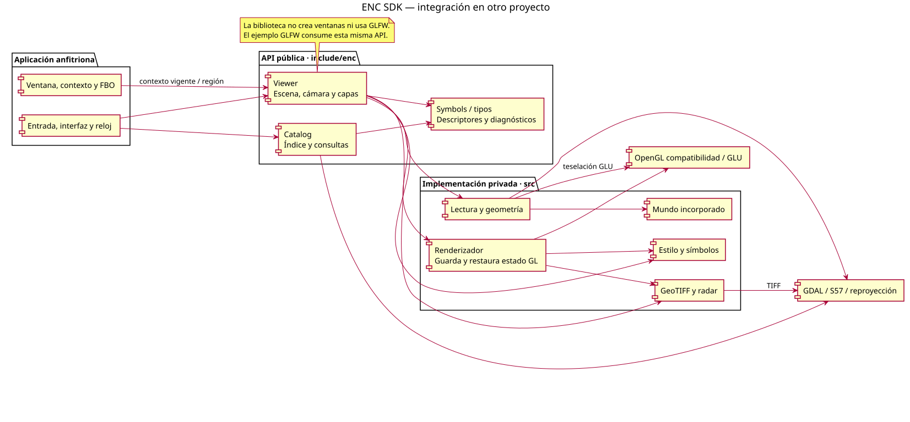
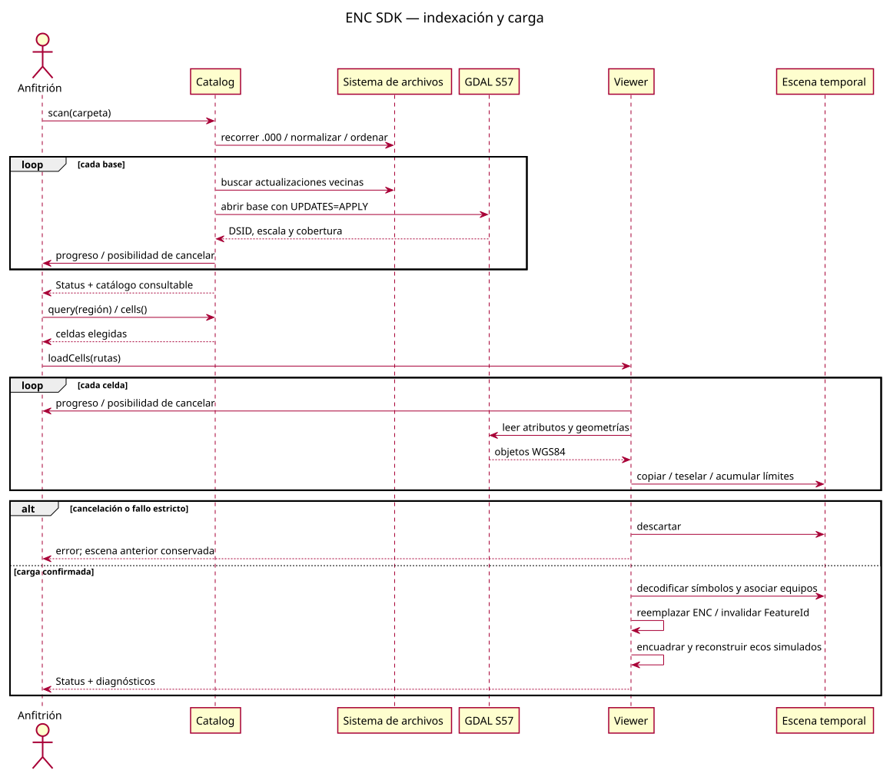
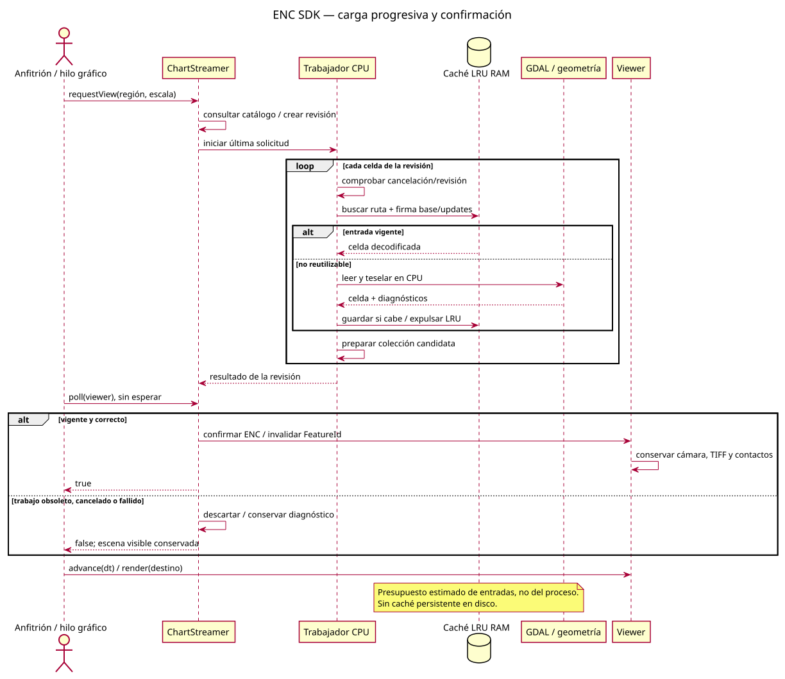
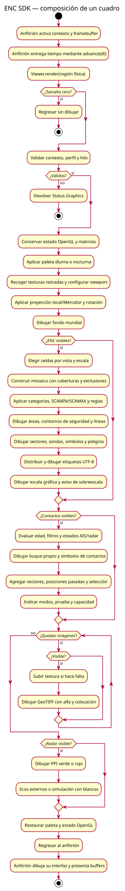
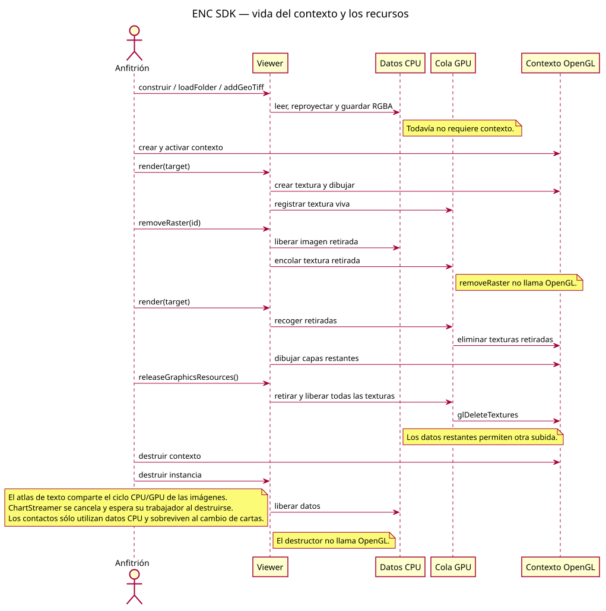

# Arquitectura y recorrido de lectura

ENC SDK separa la aplicación receptora de sus datos y algoritmos. La biblioteca
instalable es `enc::viewer`; `examples/viewer` es un consumidor que puede
compilarse de manera independiente con el paquete instalado.



## Organización

| Ruta | Responsabilidad |
| --- | --- |
| `include/enc/types.h` | Coordenadas, diagnósticos, progreso, presentación y destino físico. |
| `include/enc/catalog.h` | Índice de archivos y consultas de cobertura. |
| `include/enc/viewer.h` | API de escena, cámara, selección, imágenes, radar y renderizado. |
| `include/enc/symbols.h` | Descriptores y ejemplos consultables sin contexto. |
| `include/enc/portrayal.h` | Reglas de presentación y descripciones de clases/atributos. |
| `include/enc/streaming.h` | Solicitudes por región, caché y confirmación progresiva. |
| `include/enc/contacts.h` | Informes AIS/radar, estados, configuración y evaluación relativa. |
| `cmake/version.h.in` | Versión pública generada desde CMake en `generated/include/enc/version.h`. |
| `src/catalog.cpp`, `runtime.cpp` | Indexación, DSID, inventario y registro único GDAL. |
| `src/viewer.cpp`, `viewer_impl.h` | PIMPL, cargas transaccionales, cámara y consultas públicas. |
| `src/overlays.cpp` | Comandos de varias imágenes y configuración del radar. |
| `src/render.cpp` | Validación de contexto, estado OpenGL y composición. |
| `src/symbols.cpp` | Adaptación del catálogo privado a tipos públicos. |
| `src/navigation.cpp` | Reglas, escala, contornos, celdas candidatas e historial. |
| `src/portrayal.cpp` | Reglas predeterminadas y diccionarios descriptivos GDAL. |
| `src/streaming.cpp` | Trabajador CPU, revisiones y caché LRU de celdas decodificadas. |
| `src/contacts.cpp` | Lotes transaccionales, relojes y evaluación de contactos. |
| `src/detail/chart_reader`, `geometry` | GDAL, transformación WGS84 y teselación GLU. |
| `src/detail/chart_style`, `nautical_symbols` | Reglas visuales, asociación de equipos y dibujo vectorial. |
| `src/detail/chart_renderer`, `camera`, `picking` | Dibujo ENC/mundo, proyección y selección. |
| `src/detail/mosaic` | Cobertura, escala, categorías y condiciones de profundidad. |
| `src/detail/text_renderer` | UTF-8, medición y atlas de etiquetas incorporado. |
| `src/detail/contact_state`, `contact_renderer` | Persistencia de contactos y símbolos de seguimiento. |
| `src/detail/raster_overlay`, `overlay_renderer` | Normalización TIFF, recursos GPU y composición de capas. |
| `src/detail/radar_overlay`, `radar_scene` | Simulación, coordenadas relativas y ecos de costa. |
| `src/detail/display_theme`, `render_primitives`, `symbol_catalogue` | Paletas, texto y catálogo. |
| `examples/minimal`, `examples/advanced`, `examples/viewer` | Consumidores sin ventana, mínimo, avanzado y con interfaz completa. |
| `tests` | Contratos de CPU, renderizado EGL y fixtures. |
| `assets`, `sample-charts` | Mundo, atlas y cartas, con sus documentos de procedencia/licencia. |

Los encabezados de cada archivo explican su función. Las cabeceras públicas no
exponen GDAL ni OpenGL; sus tipos se devuelven por valor salvo las referencias
explícitas del catálogo. `Viewer::Impl` oculta estructuras y recursos internos.

## Carga



El catálogo y la escena tienen vidas independientes. Se puede inspeccionar una
colección completa y cargar sólo algunas rutas. La carga prepara una escena
candidata y confirma al finalizar; en modo estricto, un fallo o cancelación
conserva los datos anteriores. Las imágenes ya cargadas no se sustituyen al
cambiar las cartas.
Los contactos también conservan sus informes, identificadores y selección.

GDAL mantiene la propiedad de sus objetos durante la lectura. El SDK copia las
geometrías, sus atributos y las profundidades Z. GLU tesela durante la carga;
no necesita una ventana para esa operación. Los polígonos conservan contornos y
huecos para renderizado y selección.

Para [carga progresiva](carga-progresiva.md), `ChartStreamer` mantiene una copia
del catálogo, decodifica por región en un trabajador CPU y reutiliza celdas en
una caché LRU de RAM estimada. Los resultados tienen revisión; `poll(viewer)`
confirma exclusivamente la vigente desde el hilo anfitrión. No se comparte
mutación del visor con el trabajador. La confirmación reconstruye la colección
ENC e invalida sus identificadores, conservando cámara, capas y contactos.



## Composición



El orden es **mundo → ENC → GeoTIFF inferior a superior → radar → contactos**. Los controles
del anfitrión se dibujan después. Ocultar ENC revela el mundo y deja operativas
las imágenes y el PPI. La paleta sólo transforma colores al dibujar.

La geometría permanece en WGS84. La cámara ofrece proyección equirectangular
local o Mercator, con giro y normalización de longitudes en el antimeridiano. Las operaciones
interactivas trabajan en píxeles lógicos; el destino físico y el recorte
incorporan la escala HiDPI y el desplazamiento de la región dentro del framebuffer.

El mosaico ordena por escala/propósito y recorta por la cobertura efectiva de las
celdas. Las reglas y categorías se evalúan antes de dibujar. `SCAMIN/SCAMAX`,
contornos y peligros básicos comparten las decisiones entre dibujo y consulta.
El distribuidor de texto reserva símbolos y conserva posiciones candidatas;
`text_renderer` mide y dibuja un atlas UTF-8 incorporado, sin FreeType en ejecución.

`ContactsState` mantiene informes separados de las ENC. Su evaluación produce
edad, pérdida, peligro, vectores e historial. `contact_renderer` consume esos
resultados después del PPI. El anfitrión aporta sensores y reloj; `render` no
extrapola las posiciones. Ver [modelo y trazabilidad de contactos](contactos.md).

## Recursos



Las imágenes conservan RGBA en CPU. La primera visualización crea sus texturas.
Retirar una capa coloca el identificador en una cola de eliminación de su propia
instancia. `render` recoge esa cola con el contexto vigente;
`releaseGraphicsResources` libera todas las texturas antes del cierre.
El atlas de etiquetas sigue el mismo contrato de subida diferida y liberación.

No hay ventana global, callbacks GLFW ni reloj automático en la biblioteca.
`initialize()` registra controladores GDAL una vez; no destruye el registro global
al finalizar una instancia. La paleta utiliza una selección temporal local al
hilo que se restaura al salir de cada cuadro.

## Extender

- Ajustar una clase: preferir `setPortrayalRules` para categoría, prioridad y trazo.
  Para un símbolo nuevo, extender `chart_style`/`nautical_symbols`, agregar un
  ejemplo en `symbol_catalogue` y comprobar atributos/renderizado.
- Nuevo control de aplicación: sólo `examples/viewer`, mediante API pública.
- Nueva fuente radar: adaptar sus datos a `RadarEcho`; transporte y sensores
  permanecen en el proyecto receptor.
- Nueva fuente de contactos: adaptar informes a `Contact`, con IDs y tiempo
  coherentes; no incorporar transporte ni correlación de sensores al renderizador.
- Nuevo formato o estrategia de imágenes: `raster_overlay`; conservar ID y
  contrato público de colocación y recursos.
- Otro framework gráfico: reemplazar el ejemplo GLFW, conservando el contexto
  de compatibilidad y las llamadas a `resize`, `advance`, `render` y liberación.

## Diagramas editables

Las fuentes PlantUML están junto a sus SVG en `docs/diagrams`. Con PlantUML y
Graphviz instalados:

```sh
cmake --build build/dev --target enc-diagrams
# Alternativa directa, desde enc-viewer-sdk/:
JAVA_TOOL_OPTIONS=-Djava.awt.headless=true plantuml -charset UTF-8 -tsvg docs/diagrams/*.puml
```
