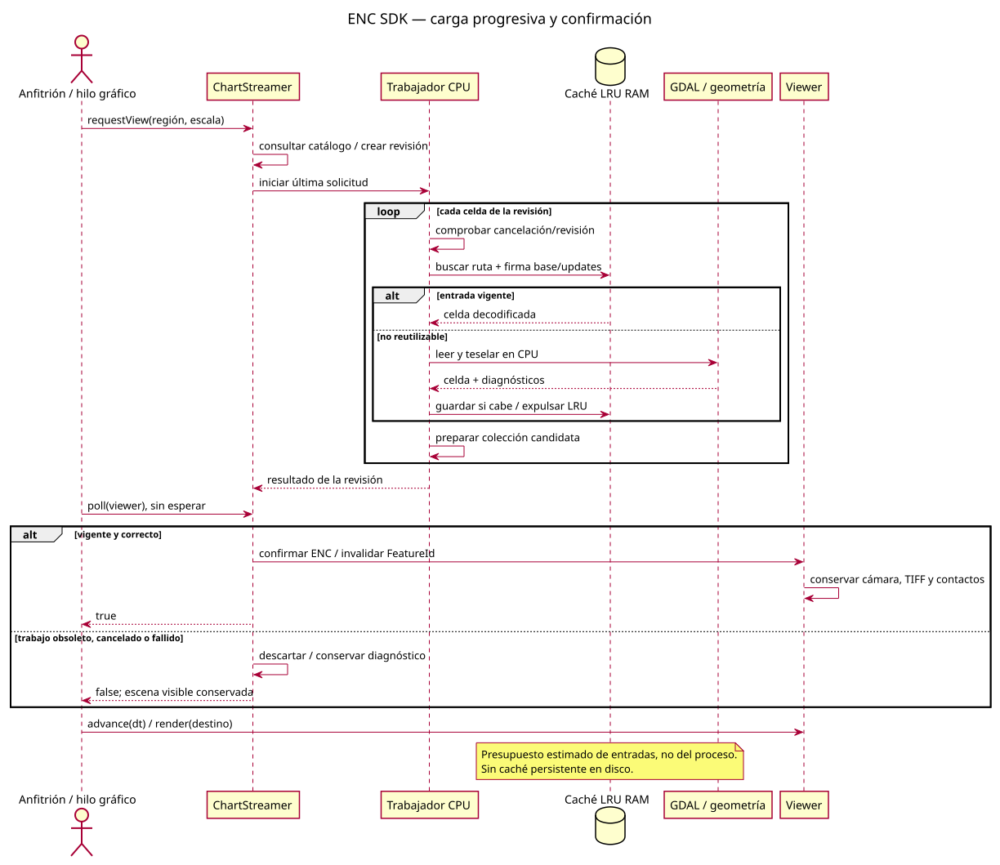

# Carga progresiva y caché de celdas

[`enc::ChartStreamer`](../include/enc/streaming.h) agrega lectura de celdas en un
trabajador CPU. El anfitrión pide una región y confirma sus resultados mediante
`poll()` desde el hilo que utiliza `Viewer`. El trabajador no llama OpenGL ni
modifica el visor mientras se renderiza.



## Integración

```cpp
#include <enc/enc.h>

enc::Catalog catalogo;
const auto indexado = catalogo.scan("/datos/enc");
if (!indexado) {
    // Informar indexado.message y detener esta inicialización.
    return;
}
enc::StreamOptions opciones;
opciones.cacheBudgetBytes = 128 * 1024 * 1024;
opciones.maxCells = 256;
enc::ChartStreamer cargador(catalogo, opciones);

// Con el visor dimensionado y su cámara ya ubicada en la región de interés:
auto estado = cargador.requestView(visor.viewBounds(64), visor.scaleInfo().denominator);

// En cada vuelta del bucle anfitrión, antes de renderizar:
if (cargador.poll(visor)) {
    // Se confirmó una colección: renovar listas de capas y FeatureId almacenados.
}
const auto progreso = cargador.info();
if (!progreso.loading && !progreso.lastResult) {
    // Mostrar el diagnóstico; las cartas anteriores siguen disponibles.
}
```

Es un fragmento del ciclo de integración; `visor` y el bucle pertenecen al
anfitrión. El [ejemplo avanzado compilable](../examples/advanced/README.md) muestra
la secuencia completa con contexto, navegación y cierre.

El constructor copia la instantánea del catálogo. Inspeccionar sus metadatos
permite elegir las celdas por región antes de leerlas. Un catálogo sin metadatos
incluye conservadoramente las celdas de extensión desconocida y las filtra tras
su lectura; por ello puede leer más datos y alcanzar antes `maxCells`.
Después de `Catalog::refresh()`,
crear otro cargador para adoptar el índice actualizado. Un presupuesto de cero
o `maxCells=0` provoca `std::invalid_argument`.

## Solicitudes y confirmación

`requestView(bounds, denominator)` selecciona celdas que intersectan la región.
El denominador, cuando es mayor que cero, prioriza la lectura de escalas próximas
a la vista; no descarta por sí mismo otras celdas intersectantes. El mosaico
aplica después sus reglas de presentación. Una región inválida o una selección
mayor que `maxCells` se rechaza, sin truncar silenciosamente la colección.

Cada solicitud válida crea una revisión. Mientras se decodifica una celda puede
quedar pendiente una solicitud nueva; sólo se conserva la última. La cancelación
se comprueba entre celdas, sin interrumpir GDAL a mitad de lectura. Una revisión
superada nunca sustituye la escena visible. `poll()` no espera al trabajador y
devuelve `true` sólo si confirmó un resultado de la revisión vigente.

Una confirmación sustituye las ENC, conserva la cámara y mantiene presentación,
imágenes, radar y contactos. Invalida los `FeatureId`, índices de capa y selección
de objetos de la colección anterior. Los identificadores de contactos e imágenes
son independientes. Una región sin celdas puede confirmar una escena ENC vacía,
dejando visible el mapa mundial.

Por defecto, cualquier fallo conserva la colección anterior. Con
`allowPartial=true` se pueden confirmar las celdas válidas y consultar los errores
en `lastResult.diagnostics`; una selección no vacía completamente ilegible falla.
La preparación y lectura ocurren en segundo plano; la confirmación y ciertos
cálculos de escena ocurren en el hilo anfitrión y pueden consumir tiempo.

## Caché y presupuesto

La caché mantiene celdas decodificadas en RAM y expulsa primero las de uso menos
reciente (LRU). La firma de cada entrada considera ruta, tamaño y modificación
de la base y sus actualizaciones vecinas. Si alguno cambia, se vuelve a leer la
celda. Esto no reemplaza el refresco del catálogo ni detecta automáticamente
nuevas bases fuera de su instantánea.

`cacheBudgetBytes` limita una **estimación** de las entradas de caché, inicialmente
128 MiB. No limita la memoria total del proceso: la escena visible, el resultado en
preparación, copias temporales, GDAL y recursos GPU consumen memoria adicional.
Una celda mayor que el presupuesto se puede cargar sin quedar almacenada.
`StreamInfo` informa entradas, bytes estimados, aciertos, fallos, progreso y revisión.

`clearCache()` retira las entradas reutilizables; no descarga la escena vigente y
un trabajo en curso puede poblarla de nuevo. No hay caché persistente en disco,
servidor de teselas ni descarga de datos.

## Concurrencia y cierre

Serializar `requestView`, `poll`, `cancel`, `clearCache`, `info` y destrucción en
el hilo anfitrión. `Viewer` conserva su contrato de llamadas serializadas. El
trabajador sincroniza internamente su caché; esto no habilita llamadas arbitrarias
simultáneas a la API pública.

`cancel()` invalida el resultado pendiente; no bloquea esperando GDAL. El destructor
cancela y espera a que termine la lectura en curso, por lo que puede demorar el
cierre. Después se liberan los recursos gráficos del visor con su contexto vigente,
como explica la [guía de integración](integracion.md).
