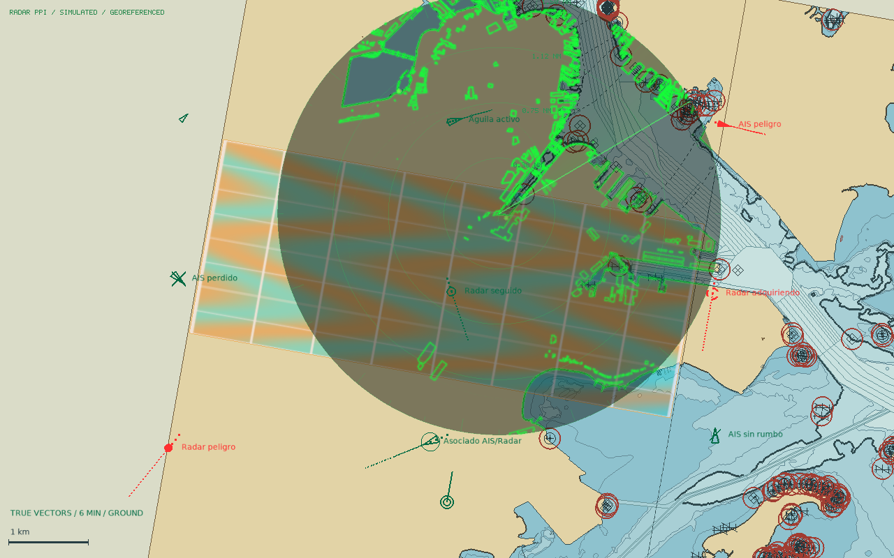
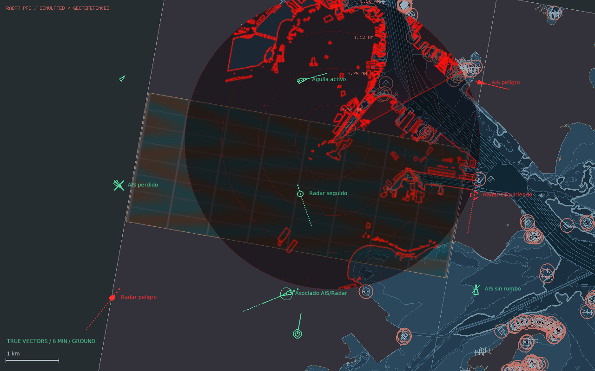

# Contactos AIS y radar rastreados

La biblioteca representa múltiples contactos recibidos por la aplicación
anfitriona, independientemente de las celdas ENC y del vídeo PPI. El modelo público
está en [`<enc/contacts.h>`](../include/enc/contacts.h) y las operaciones pertenecen
a [`enc::Viewer`](../include/enc/viewer.h). No interpreta mensajes AIS ni adquiere
blancos a partir de ecos: el anfitrión entrega informes ya procesados.



## Modelo y unidades

Cada `Contact` tiene un `id` estable suministrado por el anfitrión, una fuente
`AIS`, `Radar` o `Associated` y una posición WGS84. `name`, `mmsi` y `associatedId`
son metadatos; no identifican ni fusionan registros automáticamente. Un contacto
asociado representa una asociación ya decidida por el sistema receptor.

| Campo | Unidad y significado |
| --- | --- |
| `heading`, `courseOverGround` | Grados verdaderos en [0, 360); el rumbo orienta el símbolo y COG es su alternativa. |
| `speedOverGround` | Nudos, de 0 a 200. |
| `rateOfTurn` | Grados por minuto, signo positivo a estribor; indicador gráfico de giro. |
| `dimensions` | Metros hacia proa, popa, babor y estribor respecto de la posición reportada. |
| `timestampSeconds` | Segundos del reloj monotónico local `contactTime()`, sin conversión UTC implícita. |
| `vectorMinutes`, `tcpaLimitMinutes` | Minutos. |
| Distancia, alcance y CPA | Millas náuticas. |

Los valores opcionales ausentes permanecen desconocidos: no reemplazar un rumbo
desconocido por cero. AIS admite `Sleeping`, `Activated` y `Lost`; radar admite
`Acquiring`, `Activated` y `Lost`. Un asociado admite `Activated` o `Lost`.
La selección de un AIS dormido lo presenta activado.

## Entregar varios informes

```cpp
enc::OwnShip propio;
propio.position = {-71.04, 42.355};
propio.heading = 15;
propio.courseOverGround = 18;
propio.speedOverGround = 8;
auto estado = visor.setOwnShip(propio);

enc::Contact ais;
ais.id = "ais:366000001";
ais.mmsi = "366000001";
ais.name = "Águila";
ais.source = enc::ContactSource::AIS;
ais.state = enc::ContactState::Activated;
ais.position = {-71.03, 42.36};
ais.heading = 210;
ais.courseOverGround = 205;
ais.speedOverGround = 6;
ais.dimensions = enc::ContactDimensions{65, 15, 7, 7};

enc::Contact radar;
radar.id = "radar:18";
radar.source = enc::ContactSource::Radar;
radar.state = enc::ContactState::Activated;
radar.position = {-71.02, 42.35};
radar.courseOverGround = 270;
radar.speedOverGround = 4;
estado = visor.upsertContacts({ais, radar}); // Comprobar cada Status.

auto opciones = visor.contactSettings();
opciones.automaticDanger = true;
opciones.cpaLimitNm = 0.5;
opciones.tcpaLimitMinutes = 12;
opciones.vectors = enc::VectorMode::Relative;
estado = visor.configureContacts(opciones);
```

`upsertContacts` valida todo el lote antes de modificarlo. Rechaza identificadores
vacíos o repetidos, estados incompatibles, números inválidos, informes anteriores
al ya confirmado y desbordes de capacidad. No retira los contactos ausentes del
lote. Para eliminarlos existen `removeContact(id)` y `clearContacts()`.
La capacidad inicial es 1000 y se puede configurar hasta 10000; no se garantiza
una frecuencia de cuadro para ese máximo. `contactLayerInfo()` incluye contadores
y un aviso al alcanzar el 90 % de la capacidad.

## Reloj, pérdida y reconocimiento

El anfitrión avanza el tiempo con `advance(dt)`, que también actualiza contactos
cuando el radar está oculto o pausado. Si administra ambos relojes por separado,
puede usar `advanceContacts(dt)`; no llamar a ambos para el mismo intervalo.
`render()` no modifica el tiempo ni extrapola las posiciones reportadas.

Un informe sin `timestampSeconds` usa el tiempo local actual. Para sensores que
usen UTC u otro reloj, el adaptador debe traducir sus marcas al reloj del visor.
No se aceptan fechas futuras. Al superar `lostAfterSeconds`, inicialmente 180 s,
el estado evaluado pasa a perdido. Un nuevo informe vigente puede recuperarlo.

Peligro, pérdida y adquisición automática tienen indicación visual y parpadeo
hasta reconocimiento. `acknowledgeContact(id)` reconoce el estado actual; un
perdido reconocido deja de dibujarse, pero permanece consultable hasta retirarlo.
El reconocimiento de peligro no cancela el peligro. No hay alertas sonoras,
registro de alarmas ni gestión de alertas de puente.
Si un cambio de configuración o de datos del buque propio despeja una condición
y después vuelve a provocarla, su reconocimiento anterior no silencia la nueva
indicación.

## Vectores, trazas y CPA/TCPA

Los vectores usan COG/SOG sobre el fondo, con horizonte inicial de seis minutos.
El modo relativo resta COG/SOG del buque propio y requiere ambos datos al
configurarlo. Una leyenda indica el modo, horizonte y referencia `GROUND`.
`destination()` ofrece el avance geográfico esférico usado por los ejemplos.

Con posición y velocidad de ambos buques, `ContactInfo` informa distancia,
demora, CPA y TCPA. La evaluación es una aproximación local de velocidad
constante; un TCPA negativo corresponde a un encuentro pasado. Con
`automaticDanger=true`, sólo se marca el umbral automático en el horizonte futuro
configurado. `Contact::dangerous` permite aportar además una evaluación externa.
Con velocidad relativa cero, se usa la distancia actual como CPA y TCPA igual a
cero para evaluar la proximidad constante.
Estos valores no constituyen un sistema anticolisión validado.

Las posiciones pasadas se muestrean a intervalos regulares entre informes,
interpolando el tramo recibido; no son muestras adicionales del sensor. Por
defecto se conservan 32 puntos cada 30 s. La silueta a escala real requiere
dimensiones y rumbo, y se dibuja cuando supera 24 píxeles de longitud en pantalla.
Cambiar el intervalo de muestreo o recuperar un contacto perdido reinicia su
historial; no se mezclan intervalos ni se inventa una traza a través de la pérdida.
Los contactos conservan colores semánticos de día y de noche: el peligro sigue
rojo y los contactos normales cambian a un verde legible sobre fondo oscuro.
La presentación roja del PPI nocturno pertenece al vídeo radar, una capa distinta.

## Presentación y trazabilidad

Las referencias de presentación son las tablas 1–4 del anexo 1 de
[OMI SN.1/Circ.243/Rev.2 y Corr.1](https://wwwcdn.imo.org/localresources/en/OurWork/Safety/Documents/IMO%20Documents%20related%20to/SN.1-Circ.243-Rev.2%20%2B%20Corr.1.pdf).
La siguiente tabla describe lo que implementa este motor; no acredita conformidad
completa, ensayos normativos ni certificación OMI/IHO.

| Referencia | Implementación en la biblioteca | Fuera de alcance o parcial |
| --- | --- | --- |
| Tabla 1: buque propio | Doble círculo y línea de rumbo cuando se aporta. | Silueta propia, antena, línea transversal, vector, predictor y traza propios. |
| Tabla 2: blancos radar | Círculo, adquisición segmentada, peligro rojo, pérdida con cruz, selección por esquinas y vectores. | Adquisición/tracking del sensor y blancos de referencia. |
| Tabla 3: AIS | Triángulo dormido/activo, orientación, ausencia de rumbo, peligro, pérdida, rumbo/giro, selección y silueta. | AIS AtoN, AIS-SART, aeronaves SAR y presentación SAR específica. |
| Tabla 4: asociados | Elección AIS o radar; AIS asociado con círculo adicional y alternativa radar con triángulo inscrito en un círculo mayor. | Correlación automática de sensores. |
| Tablas 2–3: historial | Puntos separados por tiempo, derivados de los informes recibidos. | Reconstrucción de una trayectoria medida no recibida. |
| Tabla 2: prueba | `testTarget` muestra X junto al contacto y en el mapa. | Autocomprobación del equipo o del sensor. |

La simbología de cartas se documenta por separado en
[visualización S-57](visualizacion.md): este módulo de contactos no incorpora la
biblioteca de presentación IHO S-52. Los colores, tamaños y trazos son una
implementación gráfica propia sin calibración fotométrica normativa.

## Consulta y ejemplo

`contacts()` y `contact(id)` devuelven el informe y su estado evaluado, incluyendo
edad, reconocimiento y visibilidad. `pickContacts(punto, tolerancia)` devuelve
contactos visibles dentro del radio indicado, medido en píxeles lógicos desde su
punto de referencia, ordenados por distancia al cursor, aunque estén en la fase
apagada del parpadeo. `selectContact(id)` utiliza identificadores independientes
de los `FeatureId` de las cartas. Cargar o cambiar ENC conserva los contactos.

`showSleeping` y `sleepingRangeNm` filtran AIS dormidos; los contactos seleccionados
o peligrosos no se ocultan por ese filtro. Ocultar toda la capa no elimina sus
datos ni detiene su reloj. Los contactos se dibujan después de imágenes y PPI.



El [ejemplo avanzado](../examples/advanced/README.md) y el
[visor completo con `--contacts`](../examples/viewer/README.md) incluyen sensores
sintéticos que usan exactamente esta API. Ningún ejemplo requiere una conexión
AIS o radar para explorar los estados.
