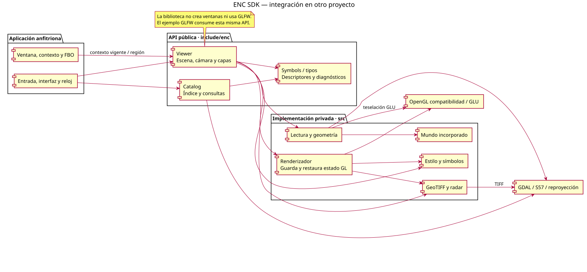
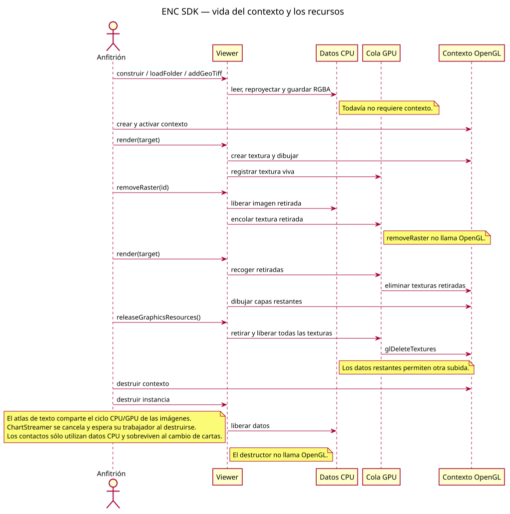

# Integrar ENC SDK en otro proyecto

La aplicación receptora crea la ventana y un contexto OpenGL de compatibilidad,
procesa su entrada y decide cuándo dibujar. ENC SDK se encarga de las cartas,
la cámara, la presentación y las capas geográficas.



## Dependencias y compilación

La biblioteca estática requiere C++17, GDAL ≥ 3.0 con controlador S57, OpenGL de escritorio
y GLU. No necesita GLFW ni EGL. El ejemplo de escritorio añade GLFW; las pruebas
gráficas añaden EGL/Mesa. El paquete se ha desarrollado y verificado en Linux;
para otras plataformas hay que validar sus toolchains y contextos.

Para incorporarla como subdirectorio:

```cmake
set(ENC_BUILD_EXAMPLES OFF CACHE BOOL "")
set(ENC_BUILD_TESTS OFF CACHE BOOL "")
set(ENC_BUILD_TOOLS OFF CACHE BOOL "")
add_subdirectory(external/enc-viewer-sdk)
add_executable(mi_aplicacion main.cpp)
target_link_libraries(mi_aplicacion PRIVATE enc::viewer)
```

También se puede instalar en un prefijo propio:

```sh
cmake -S enc-viewer-sdk -B enc-viewer-sdk/build/library -DCMAKE_BUILD_TYPE=Release
cmake --build enc-viewer-sdk/build/library --parallel
cmake --install enc-viewer-sdk/build/library --prefix /ruta/al/paquete
```

En el proyecto receptor:

```cmake
find_package(EncSDK 0.1 REQUIRED CONFIG)
add_executable(mi_aplicacion main.cpp)
target_link_libraries(mi_aplicacion PRIVATE enc::viewer)
```

```sh
cmake -S . -B build -DCMAKE_PREFIX_PATH=/ruta/al/paquete
cmake --build build --parallel
```

La configuración predeterminada construye sólo la biblioteca. Los ejemplos, herramientas
y pruebas se activan mediante las [opciones de desarrollo](mantenimiento.md).

El paquete exporta las dependencias transitivas de la biblioteca estática. No se
agregan rutas `src/` al consumidor ni se incluyen archivos `.cpp`. El mapa mundial
queda incorporado al binario, por lo que no hay que copiar `assets/` al ejecutable.
GDAL y sus datos de proyección siguen siendo dependencias del entorno de ejecución.

## Secuencia mínima

```cpp
#include <enc/enc.h>

enc::Viewer visor;
visor.resize(1024, 768); // Área lógica exclusivamente del mapa.
const auto carga = visor.loadFolder("/datos/enc");
if (!carga) {
    // Registrar carga.message y carga.diagnostics; la escena anterior se conserva.
}
visor.setTheme(enc::Theme::Night);

// Dentro del bucle propio, con el contexto de compatibilidad vigente:
visor.advance(segundosDesdeElUltimoCuadro);
const auto cuadro = visor.render({0, 0, anchoFramebuffer, altoFramebuffer});
// La aplicación presenta sus buffers y atiende eventos.

// Antes de destruir o reemplazar el contexto:
visor.releaseGraphicsResources();
```

Hay dos ejemplos compilables: [lectura sin ventana](../examples/minimal/index.cpp)
y [renderizado mínimo con GLFW](../examples/minimal/opengl.cpp). El
[visor completo](../examples/viewer/README.md) agrega paneles y controles usando
exclusivamente las cabeceras públicas.

## Indexar y elegir las celdas

`loadFolder` descubre y carga todas las bases encontradas. Si el anfitrión necesita
mostrar un catálogo, elegir una región o cargar sólo determinadas celdas:

```cpp
enc::Catalog indice;
const auto estado = indice.scan("/datos/enc");
if (estado) {
    const auto candidatas = indice.query({-72, 42, -70, 43, true});
    std::vector<std::filesystem::path> rutas;
    for (const auto& celda : candidatas) rutas.push_back(celda.path);
    visor.loadCells(rutas);
}
indice.saveInventory("inventario.json");
```

Conservar los archivos `.001`, `.002`, etc. junto a su `.000` y con el mismo
nombre base. GDAL aplica las actualizaciones al abrir la base. Revisar los
mensajes sobre secuencias incompletas o errores de actualización.

Para volver a recorrer la carpeta, llamar `Catalog::refresh()`. El SDK no instala
un vigilante ni recarga automáticamente la escena: el anfitrión decide cuándo
confirmar una nueva selección con `loadCatalog` o `loadCells`.

## Coordenadas, mouse y HiDPI

- Geografía: `GeoPoint{longitud, latitud}` WGS84 en grados.
- Navegación: píxeles **lógicos**, origen arriba a la izquierda del área del mapa.
- `RenderTarget`: píxeles **físicos**, origen abajo a la izquierda del framebuffer.
- Cámara: `pixelsPerDegree` es la escala de la proyección equirectangular local.

Si hay una barra superior, restar su altura a la posición del mouse antes de
llamar `zoomAt` o `pick`. En una pantalla de escala 2x, un mapa lógico 800×600
usa `resize(800,600)` y un destino físico de 1600×1200.

```cpp
visor.zoomAt({mouseXLocal, mouseYLocal}, 1.2);
visor.panBy(deltaXLogico, deltaYLogico);
const auto objeto = visor.pick({mouseXLocal, mouseYLocal});
visor.select(objeto ? std::optional<enc::FeatureId>(objeto->id) : std::nullopt);
```

El SDK dibuja en el framebuffer que el anfitrión haya enlazado, incluido un FBO.
No lo cambia, no ejecuta `glClear` y no intercambia buffers. Limita el dibujo a la
región entregada. La aplicación debe proporcionar un destino válido y del tamaño
suficiente para esa región.

## GeoTIFF y radar

```cpp
enc::RasterOptions imagen;
imagen.opacity = 0.65;
const auto capa = visor.addGeoTiff("ortofoto.tif", imagen);
if (capa) {
    visor.setRasterVisible(capa.value, true);
    visor.moveRasterToTop(capa.value);
}
visor.enableRadar(true); // Origen inicial sobre agua cuando hay geometría de profundidad.
```

Cada imagen tiene su ID y sus controles. Un TIFF sin georreferencia se ubica en
la vista actual; `RasterOptions::manualExtent` permite proporcionar cuatro
esquinas WGS84, desde la superior izquierda y en sentido horario. `moveRaster`,
`scaleRasterAt` y `resetRaster` modifican sólo su colocación en memoria.

Para recibir datos de un sistema radar existente:

```cpp
enc::RadarSettings radar;
radar.mode = enc::RadarMode::ExternalEchoes;
radar.visible = true;
radar.origin = {-71.04, 42.355};
radar.rangeNm = 3;
visor.configureRadar(radar);
visor.setRadarEchoes({{{-71.035, 42.36}, 0.8f}});
```

Los ecos llegan georreferenciados; el SDK no abre sockets ni implementa protocolos
radar. El modo externo no agrega ruido ni blancos sintéticos. Cambiar origen,
alcance o modo invalida esa escena externa; volver a entregar los ecos.

## Hilos, contexto y cierre



Las operaciones de carga y consulta funcionan sin contexto. Se pueden ejecutar
en un hilo de trabajo si se serializan las llamadas a esa instancia; los callbacks
de progreso deben encolar notificaciones al hilo de interfaz, sin reentrar al visor.
No cargar y renderizar simultáneamente el mismo objeto.

Cada instancia que renderiza pertenece a un contexto y un hilo gráfico. Usar
`render`, `renderSymbolCatalogue` y `releaseGraphicsResources` en ese contexto.
La biblioteca comprueba contexto disponible, perfil y hilo; comprobar que es el
**mismo contexto** sigue siendo responsabilidad del anfitrión.

Eliminar imágenes sólo encola sus texturas. El siguiente renderizado recoge esa
cola. Antes de destruir el contexto, `releaseGraphicsResources` elimina todas las
texturas, incluidas las de capas ya retiradas. Conserva los datos CPU: se puede
renderizar de nuevo en un contexto nuevo después de esa liberación.

El destructor de `Viewer` no llama OpenGL. Omitir la liberación explícita impide
recuperar texturas de un contexto que siga vivo; no usar el destructor como
sustituto de `releaseGraphicsResources`.

## Errores y estado

Comprobar `Status` y `Result<T>` mediante su conversión a `bool`. `code` permite
distinguir cancelación, ruta inválida, fallo de lectura y contexto gráfico no
compatible; `diagnostics` aporta mensajes por archivo. Los fallos operativos se
comunican por estos tipos; las excepciones estándar de memoria siguen siendo
posibles.

Las cargas son síncronas y transaccionales. Por defecto, una celda que falla
conserva toda la colección anterior. `LoadOptions::allowPartial=true` confirma las
celdas válidas e informa las descartadas. La cancelación comprueba el callback
entre celdas y antes de confirmar, conservando la escena anterior.
