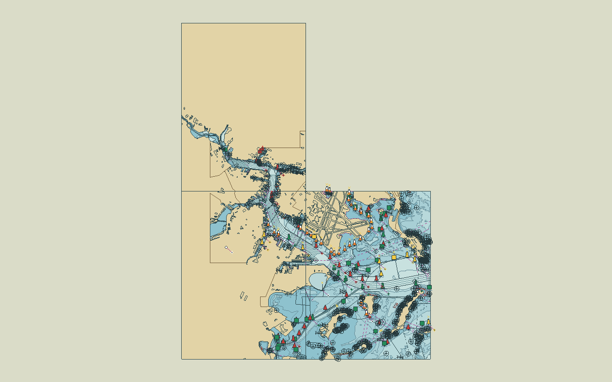
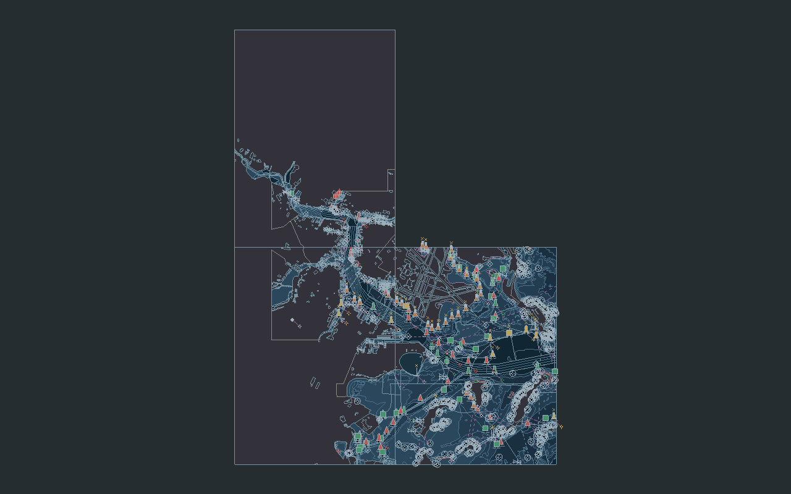
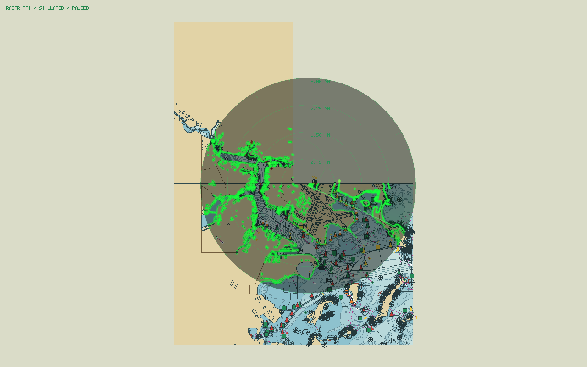
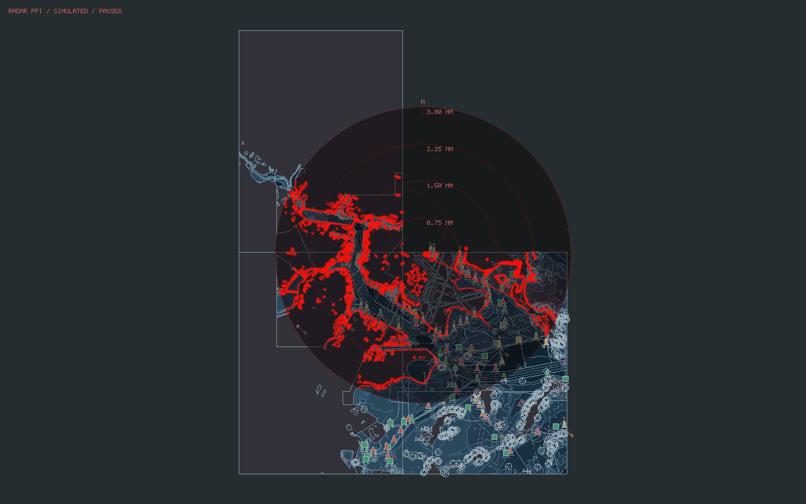
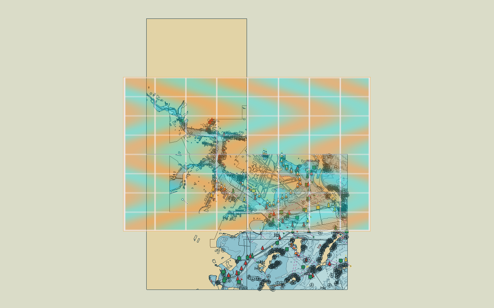
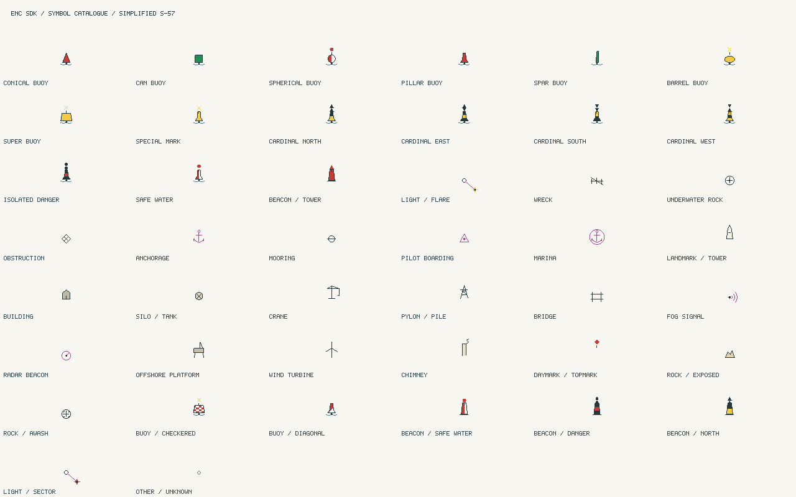
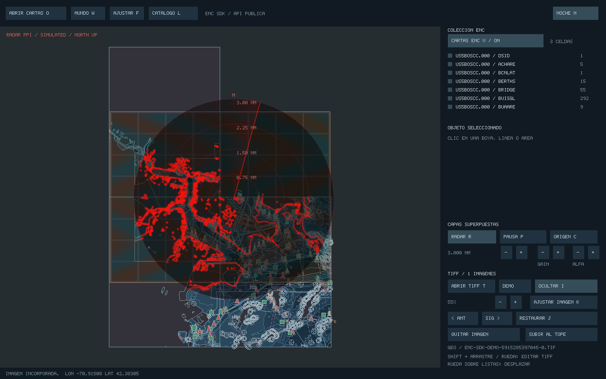

# Validación reproducible

Desde la raíz de `enc-viewer-sdk`, con las dependencias de desarrollo instaladas:

```sh
cmake --preset dev
cmake --build --preset dev
ctest --preset dev
python3 tools/format_cpp.py --check
python3 tools/check_repository.py
```

Los perfiles requieren CMake ≥ 3.21. Para CMake ≥ 3.16, usar
`cmake -S . -B build/dev -DENC_BUILD_TESTS=ON -DENC_BUILD_EXAMPLES=ON -DENC_BUILD_TOOLS=ON`,
seguido de `cmake --build build/dev` y `ctest --test-dir build/dev --output-on-failure`.

Las pruebas no necesitan una sesión de escritorio. El renderizador usa EGL y Mesa
por software mediante `LIBGL_ALWAYS_SOFTWARE=1`, configurado por CTest. La aplicación
GLFW completa requiere una sesión gráfica o Xvfb y se verifica por separado.

| Prueba | Qué comprueba |
| --- | --- |
| `enc-cpu` | Índice, 12 actualizaciones, DSID, cobertura, JSON, refresco, cancelación, carga estricta/parcial, deduplicación, cámara, selección, IDs, símbolos y TIFF sin contexto. |
| `enc-render` | Mundo, profundidades ENC, noche, varias imágenes y orden, alfa, RGB, grises de 16 bits, paletas, proyección, rotación, GCP, radar simulado/externo, pausa e HiDPI. |
| `enc-geometry` | Teselación de anillos con igual orientación, área correcta y hueco interior conservado, sin contexto gráfico. |
| `enc-package` | Instalación, traslado del prefijo y compilación/ejecución de un consumidor que sólo conoce `find_package(EncSDK)` y cabeceras públicas. |
| `enc-subproject` | Anfitrión con `add_subdirectory`, lectura de cartas y ausencia de targets adicionales por defecto. |
| `enc-headers` | Cada cabecera pública compila individualmente, sin rutas de inclusión de GDAL, OpenGL o GLFW. |
| `enc-repository` | Enlaces locales de documentación, encabezados explicativos y separación de dependencias públicas/privadas. |

Las dos últimas verificaciones se registran cuando Python 3 está disponible con
GCC/Clang. Para ejecutar pruebas sin EGL ni GLFW, usar el perfil `cpu`:

```sh
cmake --preset cpu
cmake --build --preset cpu
ctest --preset cpu
```

El test gráfico también enlaza un FBO del anfitrión y cambia viewport, scissor,
máscara de color, mezcla, shader, unidad y matriz de textura, PBO y configuración
de subida de píxeles. Comprueba que el SDK los restaura, que puede subir un TIFF
en esas condiciones y que no pinta fuera de la región entregada.

Las comparaciones de cuadros permiten hasta **0.02 % de píxeles distintos** por
rasterización de bordes OpenGL. Cámara, reloj, configuración, colores de referencia
y restauración de estado se verifican además de forma directa. Se comprueba también
que un contexto core 3.3 sea rechazado antes de ejecutar primitivas incompatibles,
cuando el controlador permite crear ese contexto.

## Capturas del renderizador

Las pruebas generan PPM en `build/dev/tests/captures`. Las versiones PNG incluidas
abajo muestran resultados del renderizador.

| Carta diurna | Carta nocturna |
| --- | --- |
|  |  |

| Radar diurno | Radar nocturno |
| --- | --- |
|  |  |

| Imagen superpuesta | Catálogo de símbolos |
| --- | --- |
|  |  |

## Ejemplo de implementación completo



Para reproducir una captura del ejemplo con una sesión gráfica:

```sh
./build/dev/examples/viewer/enc-viewer-demo ./sample-charts --radar --demo-tiff --night \
    --smoke-frames 4 --screenshot ./build/dev/viewer.ppm
```

Para comprobarlo contra la biblioteca instalada, sin acceso a cabeceras privadas:

```sh
cmake --install build/dev --prefix "$PWD/install"
cmake -S examples/viewer -B build/consumer -DCMAKE_PREFIX_PATH="$PWD/install"
cmake --build build/consumer --parallel 2
./build/consumer/enc-viewer-demo "$PWD/sample-charts" --radar --demo-tiff
```

La colección incluida contiene tres celdas, con 161 capas, 6650 objetos y 155434
triángulos al aplicar sus actualizaciones. Los fixtures TIFF son pequeños y se
generan durante las pruebas; no requieren descargas.

La matriz de [GitHub Actions](../.github/workflows/ci.yml) reproduce las comprobaciones
con GCC y Clang. Los artefactos de cada ejecución contienen capturas, paquetes e
informes; consultar su resultado para conocer la validación del commit correspondiente.
Los procedimientos de distribución se describen en [mantenimiento](mantenimiento.md).
